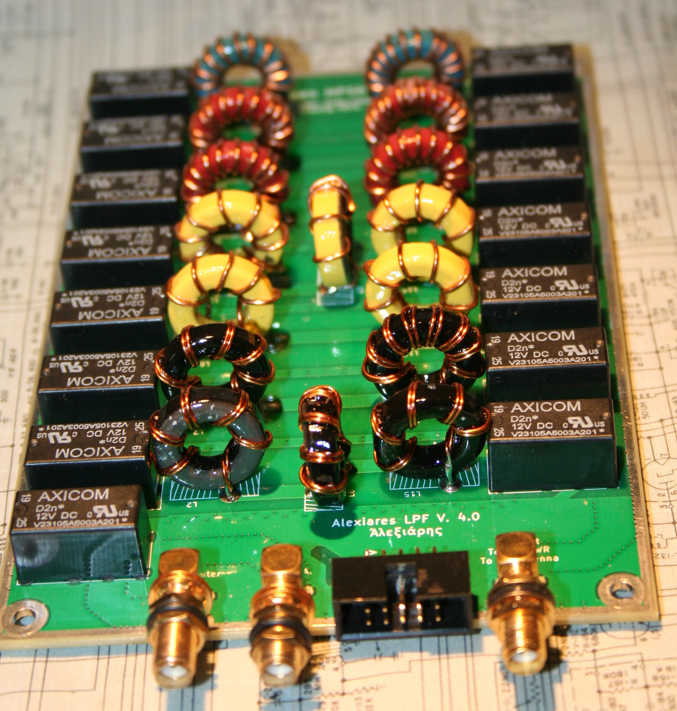

# Alexiares_LPF

This repository contains the up to date version of the OpenHPSDR Low Pass Filter project (Alexiares frontend).

  **Pour plus d'informations, consultez le Wiki associé à cette page**
  
  **For more information, see the Wiki associated with this page**
  

**Important notice**  : please check the "Branch" pull-down menu to see the different versions of the pcb

This work is protected by the TAPR Open Hardware Licence  [https://www.tapr.org/ohl.html](https://www.tapr.org/ohl.html)

Original work by Graham Haddock, KE9H and Phil Harman, VK6APH/VK6PH

Board's dimensions 10x15cm , 4 layers

**More info and building instruction** on the  [dedicated Wiki page ](https://github.com/F6ITU/Alexiares_LPF/wiki) 

So far, the Alex project under Kicad contains:

AlexI2C

Alexandrie

Alexiares_Coax_Out

Alexiares_HPF

Alexiares_LPF (this one)

Mentor

Cerberus

Aion